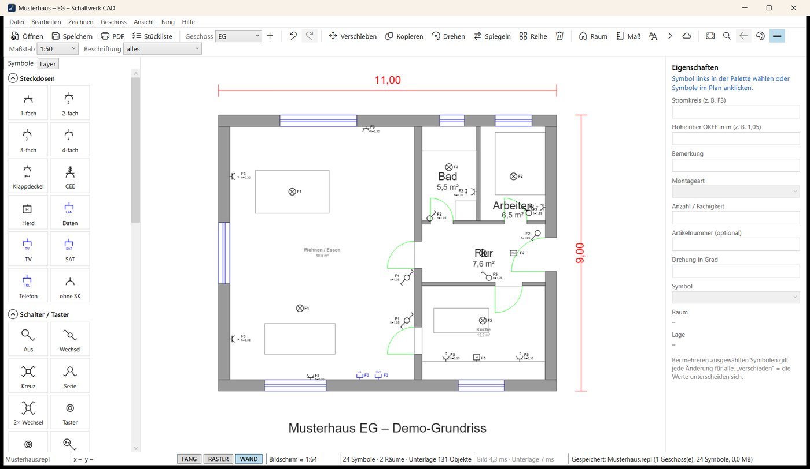
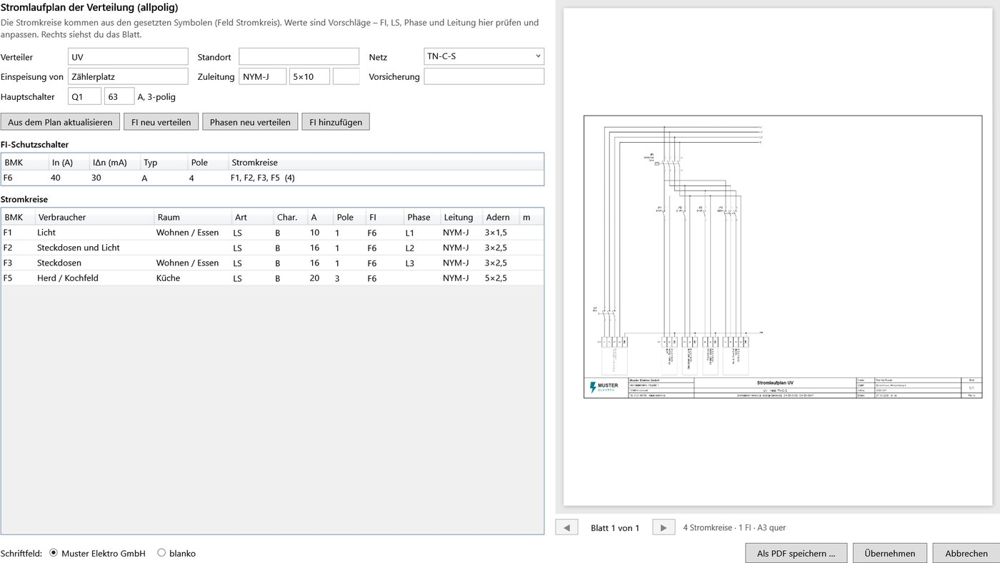
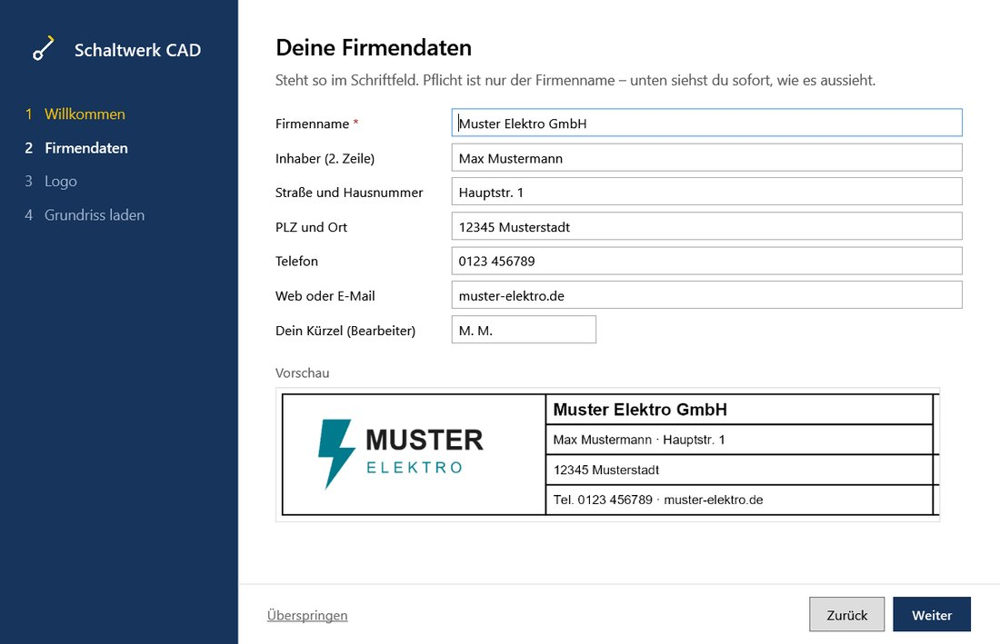
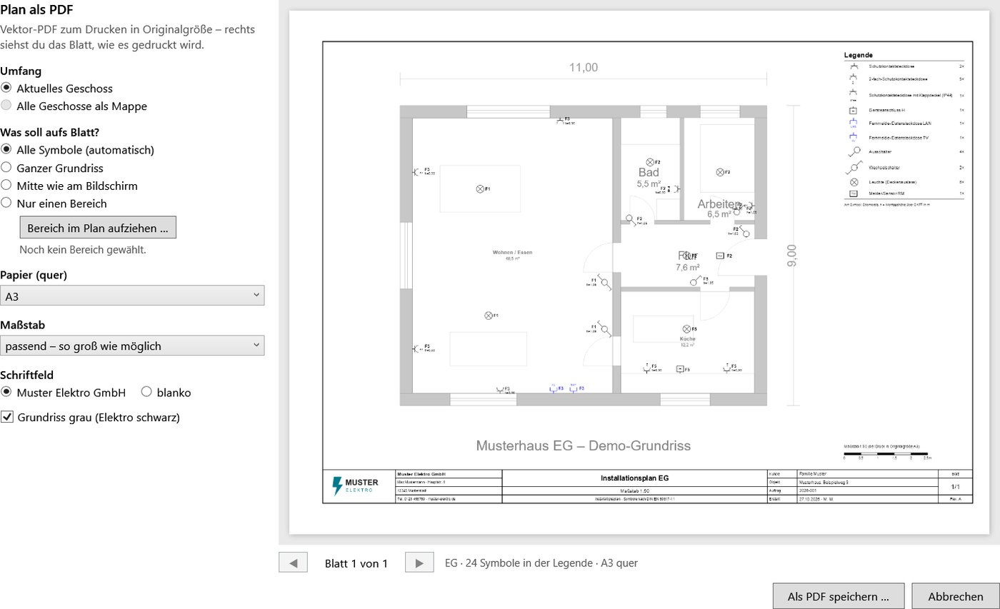
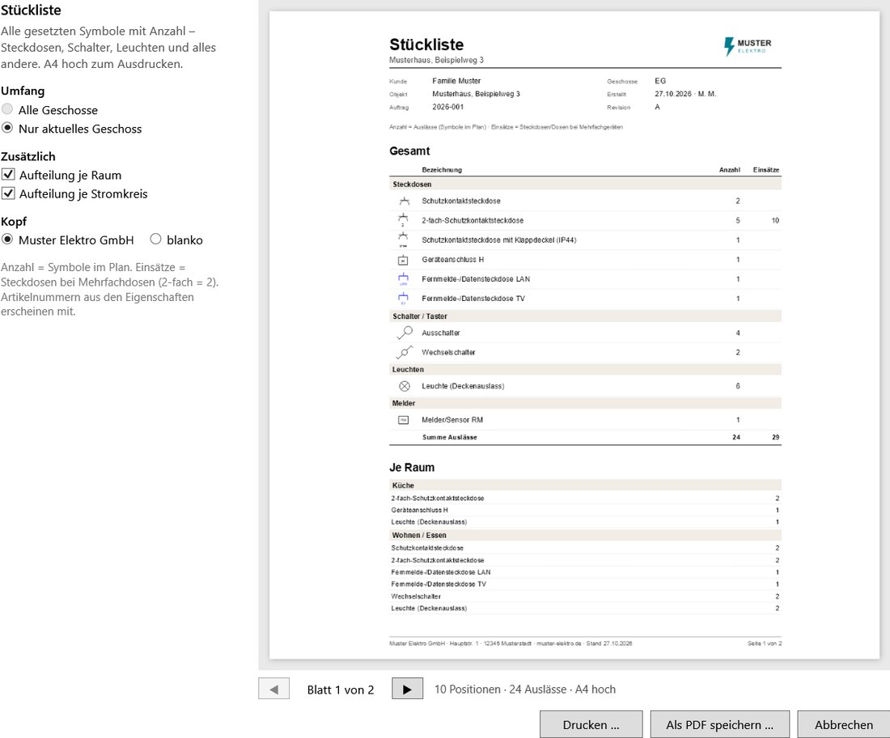

# Schaltwerk CAD

**Elektroinstallation in DXF/DWG-Grundrisse einzeichnen – kostenlos, für Windows.**

Grundriss vom Architekten öffnen, Steckdosen, Schalter, Leuchten und Melder nach DIN EN 60617-11 an die Wand klicken, Stromkreise und Höhen eintragen – und als maßstabsgetreues PDF mit Legende und eigenem Schriftfeld, als Stückliste oder zurück als DXF/DWG ausgeben.

## Download

➡️ **[Neueste Version herunterladen](../../releases/latest)** – `SchaltwerkCAD Setup x.y.z.exe`

- Installiert ohne Adminrechte für deinen Benutzer (Startmenü, `.repl`-Projekte per Doppelklick).
- Oder die **portable EXE** – läuft ohne Installation, z. B. vom USB-Stick.
- Windows 10/11, 64 Bit. Kein Konto, kein Abo.
- Beim ersten Start warnt Windows eventuell („Der Computer wurde durch Windows geschützt“), weil das Programm nicht signiert ist: *Weitere Informationen › Trotzdem ausführen*.

Updates kommen von selbst (ab Version 1.5.0): Das Programm lädt eine neue Version im Hintergrund und prüft sie, dann erscheint oben *Update bereit – Jetzt neu starten*. Ohne Klick wird beim Schließen installiert. Die portable EXE zeigt stattdessen einen Hinweis mit *Jetzt herunterladen*.

## Was es kann

- **Ersteinrichtung**: Beim ersten Start führt das Programm durch deine Firmenstammdaten und dein Logo – mit Live-Vorschau des Schriftfelds – und lädt danach deinen ersten Grundriss.
- **DXF und DWG öffnen** – ohne Zusatzprogramm. Der Grundriss bleibt als gesperrte, graue Unterlage unverändert.
- **Symbole setzen** mit Wandfang: Steckdosen und Schalter rasten an der Wand ein und zeigen in den Raum. Objektfang, Raster, Reihe, Verschieben, Drehen, Spiegeln, unbegrenztes Rückgängig. Den Plan schiebst du mit gedrückter Maustaste auf einer leeren Stelle.
- **Stromkreis, Höhe, Bemerkung, Artikelnummer** je Symbol, Beschriftung im Plan wahlweise knapp oder vollständig.
- **Räume per Klick** mit Fläche – die Symbole im Raum werden automatisch zugeordnet.
- **Bemaßung**, Kettenmaß, Höhenkote, Text, Hinweislinie, Revisionswolke.
- **Projekte mit mehreren Geschossen**, automatische Sicherung alle 2 Minuten, Wiederherstellung nach Absturz.
- **Plan als PDF mit Vorschau**: A4/A3/A2, Maßstab oder „so groß wie möglich“, ganzer Plan, alle Symbole oder nur ein aufgezogener Bereich, Legende mit Stückzahlen, Mappe über alle Geschosse.
- **Stückliste** der gesetzten Steckdosen, Schalter, Leuchten – gesamt, je Raum und je Stromkreis, zum Drucken oder als PDF.
- **Stromlaufplan der Verteilung** (allpolig) direkt aus den Stromkreisen im Plan: Einspeisung, Hauptschalter, Schienen, FI mit LS, Abgangsklemmen – Vorschlag für FI-Belegung, LS und Phasen, in einer Tabelle anpassbar, als A3-PDF mit Schriftfeld. Geht auch ganz ohne Grundriss: Stromkreise selbst anlegen, sortieren, löschen.

- **Eigener Firmenkopf**: Firmenname, Adresse und Logo im Schriftfeld – oder blanko.
- **Export** als DXF/DWG mit echten Blöcken und Attributen und als JSON für den [Elektroplan-Skill](https://github.com/julayyt/elektroplan).

| Ersteinrichtung | PDF mit Vorschau | Stückliste |
|---|---|---|
|  |  |  |

Alles Weitere steht in der **Kurzanleitung** (liegt jedem Release bei, im Programm mit <kbd>F1</kbd>).

## Hinweise

- Schaltwerk CAD ist ein Zeichenwerkzeug und ersetzt keine Fachplanung. Pläne und Normangaben prüft die verantwortliche Elektrofachkraft.
- Datenschutz: Das Programm verschickt keine Pläne oder persönlichen Daten. Für den Update-Hinweis fragt es bei GitHub nur die neueste Versionsnummer ab (abschaltbar in den Einstellungen).
- Kostenlos nutzbar, privat und beruflich – siehe [Nutzungsbedingungen](Nutzungsbedingungen.txt). Verwendete Open-Source-Bibliotheken: [Drittanbieter](Drittanbieter.txt).

Fehler gefunden oder einen Wunsch? → [Issue anlegen](../../issues)

© 2026 Julius Rau
